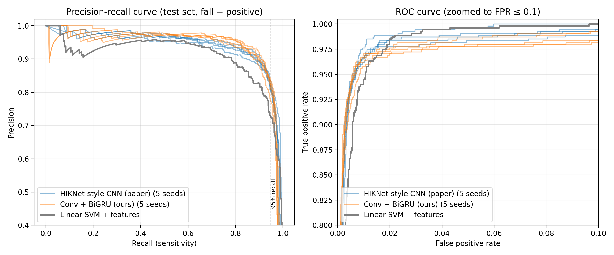

# Impact Detection — Fall Detection from Wearable IMU Data

Detecting falls (and the moments just before them) from a 6-axis wearable sensor (3-axis accelerometer + 3-axis gyroscope) using the **SisFall-Enhanced** dataset. The project is inspired by the Stanford CS229 report *"Neural Network for Detecting Head Impacts from Kinematic Data"* (Fanton, Gaudio, Ling, 2018), which showed that a small CNN (**HIKNet**) beats a hand-crafted-feature SVM at telling real impacts from false triggers in 6-axis mouthguard data. We carry the same idea over to fall/impact detection and compare three models: a hand-crafted-feature **Linear SVM** baseline, a **HIKNet-style CNN** (simplified from the paper), and our own **Conv + BiGRU** network.

- Reference paper: https://cs229.stanford.edu/proj2018/report/7.pdf
- Dataset: https://www.kaggle.com/datasets/nvnikhil0001/sisfall-enhanced
  Derived from *SisFall: A Fall and Movement Dataset* (A. Sucerquia, J. D. López, J. F. Vargas-Bonilla, *Sensors*, 2017, 17(1), 198; https://doi.org/10.3390/s17010198; CC BY 4.0).
- Colab notebook: https://colab.research.google.com/drive/13GbbA9rlXEmTKvtnnCat0qoG7INRqrM2?usp=sharing

## Problem

Falls are a leading cause of injury in older adults, and a fast, reliable alert matters. Given a short window of inertial sensor data, classify it as:

| Label | Class | Meaning |
|---|---|---|
| 0 | `nonfall` | Normal daily activity |
| 1 | `prefall` | Window just before a fall |
| 2 | `fall` | The fall/impact itself |

Note: the dataset page does not document the label order or the channel order. We inferred 0 = nonfall, 1 = prefall, 2 = fall, and ax/ay/az/gx/gy/gz, from class counts and signal statistics (peak acceleration and angular velocity increase from class 0 to class 2).

The main task is **binary: fall vs. everything else**. Because falls are rare, we report precision–recall metrics (AUC-PR, precision at 95 % recall) alongside AUC-ROC rather than plain accuracy. A secondary **3-class** experiment also tries to separate pre-fall windows.

## Relation to the reference paper

| | Reference paper (CS229, 2018) | This project |
|---|---|---|
| Task | Real head impact vs. false positive (mouthguard) | Fall vs. non-fall (and pre-fall) from wearable IMU |
| Data | 527 labelled impacts, 199 × 6 windows, 1000 Hz | SisFall-Enhanced, 256 × 6 windows, 3 classes, pre-split train/val/test |
| Input signals | Linear acceleration + angular velocity (6 channels) | Accelerometer + gyroscope (6 channels) |
| Model idea | HIKNet: 1-D temporal convs, then a late 2-D conv that fuses sensors, global average pooling, dropout 0.4, kernel width 15 | Same structure (`HIKNetLike`: 2 temporal convs, one 2-D fusion conv, global average pooling, dropout 0.4, kernel 15), with 32 base filters instead of the paper's tuned 150 |
| Baseline | SVM on features chosen by sequential feature selection | Linear SVM on hand-crafted magnitude / FFT features |
| Training | Keras/TensorFlow, early stopping on eval loss, 10 repeats | PyTorch, early stopping on validation loss, 5 seeds |
| Metrics | Accuracy, precision, specificity, sensitivity, AUC-ROC, AUC-PR | Sensitivity, specificity, precision, AUC-ROC, AUC-PR, precision at 95 % recall (better suited to rare falls) |

The paper's mouthguard dataset (Camarillo Lab, Stanford) is not public, so we used SisFall-Enhanced as a substitute with the same input format (6-channel IMU windows) and applied the same method to a related event-detection problem. Results are therefore not directly comparable to the paper's.

Our addition is the **Conv + BiGRU** model, which tests whether explicit sequence modelling helps over a purely convolutional design.

## Repository structure

```
impact-detection/
├── preprocess.py      # data loading, train-only standardisation, class weights
├── models.py          # HIKNetLike (CNN) and ConvBiGRU (Conv + bidirectional GRU)
├── baseline_svm.py    # hand-crafted features + Linear SVM baseline
├── train.py           # trains/evaluates the deep models (binary or 3-class)
├── summarize.py       # mean ± std over seeds -> results/summary.txt
├── make_figure.py     # PR and ROC curves -> results/curves.png
├── requirements.txt
├── data/              # put the dataset here (see below)
└── results/           # saved weights (.pt), test scores (.npy), 3-class training log, figure
```

## Setup

Tested with Python 3.12 (local) and Google Colab's default Python. A GPU is optional but speeds up training (`train.py` uses CUDA automatically if available).

```bash
git clone https://github.com/divyaa-rukshana/impact-detection
cd impact-detection
python -m venv venv
source venv/bin/activate        # Windows: venv\Scripts\activate
pip install -r requirements.txt
```

### Get the data

1. Download **SisFall Enhanced** from Kaggle (link above) and unzip it.
2. Place the three-class files so the layout is:

```
data/Three Classes/
├── x_train_3   y_train_3
├── x_val_3     y_val_3
└── x_test_3    y_test_3
```

Each `x_*` file is raw `float32`, shaped `(N, 256, 6)` (256 time steps × 6 channels: ax, ay, az, gx, gy, gz). Each `y_*` file is raw `uint8`, one-hot with 3 columns.

> Note: The dataset is not included in this repository; download it from Kaggle as described above.

## Run

```bash
# 0. Sanity check: identify classes and compute class weights
python preprocess.py

# 1. Baseline: hand-crafted features + Linear SVM (binary fall vs. rest)
python baseline_svm.py

# 2. Deep models, binary fall detection (repeat for seeds 0-4)
python train.py --model hiknet --task binary --seed 0
python train.py --model gru    --task binary --seed 0

# 3. 3-class experiment (nonfall / prefall / fall)
python train.py --model gru --task three --seed 0

# 4. Aggregate results and plot curves
python summarize.py       # writes results/summary.txt
python make_figure.py     # writes results/curves.png
```

Run all five seeds in one go:

```bash
for s in 0 1 2 3 4; do
  python train.py --model hiknet --task binary --seed $s
  python train.py --model gru    --task binary --seed $s
done
```

`train.py` options: `--model {hiknet,gru}`, `--task {binary,three}`, `--epochs` (30), `--patience` (5, early stopping on validation loss), `--bs` (256), `--lr` (1e-3), `--seed` (0).

## Implementation overview

- **Preprocessing** – per-channel standardisation using *training-set* mean/std only (no leakage into val/test).
- **Class imbalance** – `pos_weight` in `BCEWithLogitsLoss` (binary) or inverse-frequency weights in `CrossEntropyLoss` (3-class).
- **Baseline (SVM)** – features from accelerometer/gyroscope magnitude (max, min, mean, std, peak position, low/mid/high FFT band energy) plus per-channel max/min/std, fed to a class-balanced `LinearSVC`.
- **HIKNet-style CNN** – following the paper's design, temporal convolutions (kernel 15) are applied independently per channel, followed by a 2-D convolution that fuses all 6 channels (late sensor fusion), global average pooling, dropout 0.4.
- **Conv + BiGRU** – two strided 1-D convolutions shorten the sequence 4×, a bidirectional GRU (hidden 64) models the timeline, and mean + max pooling feed the classifier (dropout 0.3).
- **Training** – Adam (lr 1e-3), batch 256, up to 30 epochs, early stopping on validation loss, best checkpoint restored; 5 random seeds per model.

## Results (test set, fall = positive; deep models: mean ± std over 5 seeds)

| Model | AUC-PR | AUC-ROC | Precision @ 95 % recall |
|---|---|---|---|
| Conv + BiGRU | 0.939 ± 0.007 | 0.995 ± 0.001 | 0.810 ± 0.021 |
| HIKNet-style CNN | 0.938 ± 0.004 | 0.997 ± 0.001 | 0.813 ± 0.011 |
| Linear SVM + features (1 run) | 0.909 | 0.997 | 0.726 |

The Linear SVM baseline (single run) reaches AUC-PR 0.909, AUC-ROC 0.997 and precision 0.726 at 95 % recall on the test set. Both deep models are better on AUC-PR (about 0.94) and on precision at 95 % recall (about 0.81), while the SVM's AUC-ROC is comparable to HIKNet's. Curves are in `results/curves.png`. 3-class (Conv + BiGRU, seed 0, test): fall recall 0.967 / precision 0.603, pre-fall recall 0.854 / precision 0.111, fall-vs-rest AUC-PR 0.881.



## Reference

M. Fanton, N. Gaudio, A. Ling. *Neural Network for Detecting Head Impacts from Kinematic Data.* Stanford CS229 Project Report, 2018. https://cs229.stanford.edu/proj2018/report/7.pdf (HIKNet builds on PerceptionNet: Kasnesis et al., 2018).

## Reproducibility

Seeds are set with `torch.manual_seed` / `np.random.seed`. Trained weights (`results/*.pt`) and test-set scores (`results/*_test_scores.npy`) for all seeds are included, so `summarize.py` and `make_figure.py` can be re-run without retraining. Runs on GPU are not bit-for-bit repeatable, so results may differ in the last decimal places.

## Limitations

- The train/val/test splits come pre-made and shuffled, with no subject IDs. Windows from the same person or recording may appear in more than one split, so the reported scores are probably optimistic compared with evaluation on unseen people.
- Pre-fall windows are very rare and look similar to normal motion, so precision for that class is low.
- Windows come from a lab dataset (SisFall) with scripted falls; real-world performance may differ.
- Our HIKNet-style model is a simplified re-implementation (32 filters, no hyper-parameter sweep), not an exact reproduction of the paper's tuned network.

